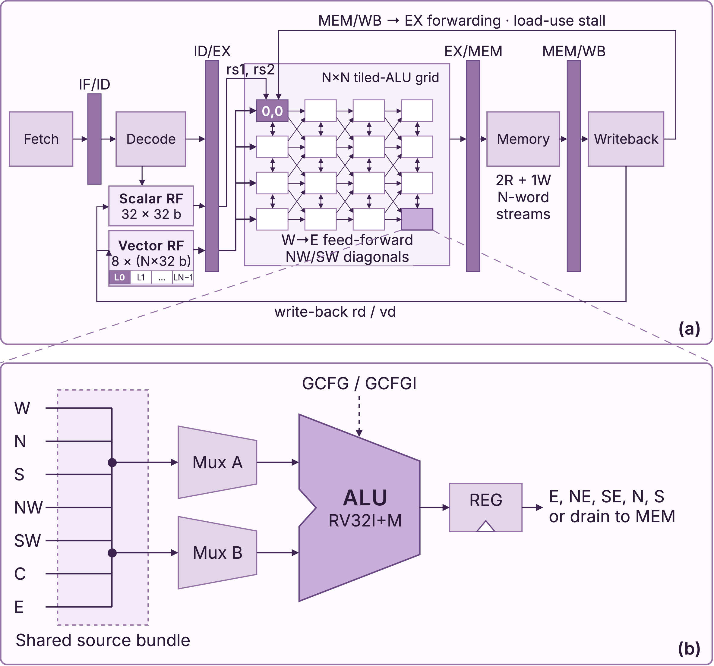

# TALU: a Tiled-ALU Grid in the RISC-V Execute Stage

Artifact for the paper

> **TALU: A Reconfigurable Tiled-ALU Grid for RISC-V**
> Ali Emre Oztas, Can Erim Karsal, Mahir Demir, Mikel Luján.
> IEEE ISCAS (under review).

TALU is a 5-stage RV32I + MUL core whose execute stage is an N×N grid of
registered ALU tiles instead of a single ALU. Tile (0,0) is also the ordinary
scalar ALU, so the same fabric runs scalar code, one deep dependent
expression fused across columns, or N lanes in parallel. Data only flows
forward (west to east), and diagonal (NW/SW) links let a reduction collapse
inside the streaming pass instead of in a separate pass over the data. A
small custom extension (`GCFG`, `GCFGI`, `GSTART`, `GFLOW`) configures each
tile and streams memory through the grid at one N-wide block per cycle.

This repository contains the RTL, the testbenches, the kernels, the compiler,
the harness for the two vector-processor baselines, and one command per
simulation result of the paper.



*(a) The N×N grid in the EX stage, fed by the scalar and vector register
files; tile (0,0) is the scalar ALU. (b) One tile: two operand muxes over the
same source bundle (W, N, S, NW, SW, the tile constant C, the stream tap E),
an RV32I+M ALU and an output register. Every tile is registered, so a longer
path costs latency, not clock period.*

## Results at a glance

On the RISC-V² paper's benchmark suite, 1024 elements, 4 lanes/rows:

| | TALU (1 GHz RTL) | RISC-V² | Vicuna |
|---|---:|---:|---:|
| geomean speedup of TALU (cycles) | | **3.2×** | **7.4×** |
| reduction cost, dot ÷ vvadd | **1.05** | 1.96 | 1.26 |
| deep chain cost, (a+b)⁸ ÷ vvadd | **1.07** | 2.05 | 2.22 |

In the paper's 45 nm implementation (FreePDK45, typical corner), the N=4 core
places and routes at **1032 MHz** in **0.30 mm²** of die, half the area
RISC-V² reports.

## Repository layout

```
rtl/          the 1 GHz core (two-stage tiles) -- used for every result
rtl_base/     the baseline core (one-stage tiles) -- Table I "base"
tb/           self-checking unit testbenches + the program-level testbench
tests/        assembly programs and their end-to-end checker (run_all.py)
tools/        assembler (asm.py) and the experiment scripts
compiler/     C -> LLVM pass -> grid configuration (needs LLVM 20)
compare/      TALU kernels, RISC-V^2 / Vicuna harness, Table I driver
scripts/      plotting
docs/         the 1 GHz core's design notes, figures
```

## Requirements

Tested on Ubuntu with the versions in brackets.

| for | needs |
|---|---|
| simulation, tests, every cycle count | Icarus Verilog (12.0), Python 3 (3.13) |
| lint | Verilator (5.042) |
| Fig. 4 plot | matplotlib (3.11) |
| compiler | clang-20 and opt-20 with LLVM 20 development headers |
| RISC-V² and Vicuna columns | git, Verilator, a C++ compiler; for Vicuna a GCC with the V extension, e.g. xPack `riscv-none-elf-gcc` (15.2.0) |

Everything runs on open-source tools.

## Quick start

```sh
make test          # lint, unit testbenches, 16 programs on both cores,
                   # and architectural equivalence of the two cores
make baselines     # once: fetch RISC-V^2 and Vicuna at pinned commits,
                   # apply our two patches, build the Vicuna simulator
make paper         # regenerate every table, figure and in-text number
```

`make paper` takes about 3 minutes on a 32-thread machine once the baselines
are built. Each command prints its table and also saves it under `results/`.

## Reproducing the paper

| paper | command | what to look for |
|---|---|---|
| Table I | `make table1` | cycles per kernel; geomean 3.2× / 7.4×; dot÷add 1.05 vs 1.96 / 1.26 |
| Sec. IV "From cycles to time" | `make table1` | 3.3× geomean at 1.032 vs 1 GHz; retiming +1.8 % cycles |
| Sec. IV "Cycle model and vector length" | `make numbers` | dot÷add 1.17 / 1.05 / 1.01 vs 1.85 / 1.96 / 1.99 at AVL 256 / 1024 / 4096 |
| Sec. IV retiming cost vs AVL | `make numbers` | +13.6 % at AVL 64, +0.5 % at 4096 |
| Sec. IV "Deep chaining vs. scalar" | `make numbers` | (a+b)⁸ 77.4× vs the scalar loop; 12.8× from streaming at N=1, then 3.8× from width |
| Fig. 4 | `make fig4` | tree 1.04× better on whole-vector; diagonal 14.4× on segmented, 1.45× packed |
| Sec. IV "Memory model" | `make numbers` | staggered placement within 3 cycles of ideal, naive up to 1.95×; advantage holds down to 1.5N words/cycle |
| Sec. III-B compiler | `make compiler`, `make numbers` | 11 of 12 kernels map; every compiled kernel with a hand-written counterpart is tile-for-tile identical, same cycles |
| Table II, throughput columns | `make scaling` | add el/cyc 0.98 / 1.94 / 3.75 / 6.87 and dot÷add 1.00 / 1.01 / 1.05 / 1.30 for N = 1 / 2 / 4 / 8; same at N=4 with column-0 multipliers |

`make table1` without `make baselines` fails on the vector-core columns;
`python3 compare/table1.py --talu-only` gives the two TALU columns alone.

## Running your own code

```sh
make sim                                          # build/run (rtl/), build/run_base
python3 tools/asm.py tests/stream_dot_small.s -o build/dot.hex
vvp build/run +PROG=build/dot.hex +DUMP=1         # cycles + final state
```

A dot product on the N=4 grid (this is Fig. 3 of the paper):

```asm
gcfg 0,0, mul, W,W, 0        # column 0: four lane-wise products
gcfg 1,0, mul, W,W, 0
gcfg 2,0, mul, W,W, 0
gcfg 3,0, mul, W,W, 0
gcfg 0,1, copya, W,W, 0      # carry p0, p1 forward along their rows
gcfg 0,2, copya, W,W, 0
gcfg 1,1, copya, W,W, 0
gcfg 2,1, add, W,SW, 0       # p2+p3            (SW = row below, previous column)
gcfg 1,2, add, W,SW, 0       # p1+(p2+p3)
gcfg 0,3, add, W,SW, 1       # p0+... -> drain to memory
gflow x5, x6, x7, x8, 1      # stream x8 blocks of src1@x5, src2@x6; accumulate to @x7
```

`gcfg row, col, OP, srcA, srcB, drain` configures one tile; operands come
from `W N S NW SW` neighbours, the tile constant `C` (`gcfgi row, col, rs`),
or `E`, the second input stream tapped at any column. `gflow src1, src2,
dst, blocks, mode` streams N-wide blocks through the grid, one per cycle;
mode 1 accumulates the drained values into a scalar. `tools/asm.py` documents
the encodings, and `compiler/README.md` shows how C loops are mapped
automatically.

## The two cores

`rtl/` is `rtl_base/` retimed for 1 GHz: two-stage tiles with the multiplier
cut inside its carry-save tree, forwarding decided in ID, a registered branch
redirect and a carry-save `GFLOW` accumulator. It costs 1.8 % cycles on the
benchmark suite and computes identical architectural state on every kernel
(`make equiv`). [docs/rtl_1ghz.md](docs/rtl_1ghz.md) lists the changes.

## Baselines

`compare/setup_baselines.sh` clones
[RISC-V²](https://github.com/ic-lab-duth/RISC-V-Vector) (`8ded0f4`) and
[Vicuna](https://github.com/vproc/vicuna) (`debfb03`) and applies two
simulator-only patches in `compare/patches/`: a Verilator-compatible include
for RISC-V², and a program-cycle counter on stderr for Vicuna. No RTL logic
changes. RISC-V² runs 4 lanes with ideal memory; Vicuna runs `Zve32x` on an
Ibex host with `VREG_W=128`, `VMEM_W=64`, LMUL 8, and its fixed 21-cycle
start-up is subtracted. The RISC-V² `fir` and `saxpy` kernels are that
repository's own examples; `compare/riscv2_bench/` and
`compare/vicuna_bench/` hold the others.

## Citation

```bibtex
@inproceedings{talu,
  title     = {{TALU}: A Reconfigurable Tiled-{ALU} Grid for {RISC-V}},
  author    = {Oztas, Ali Emre and Karsal, Can Erim and Demir, Mahir and Luj{\'a}n, Mikel},
  booktitle = {IEEE International Symposium on Circuits and Systems (ISCAS)},
  note      = {under review}
}
```
